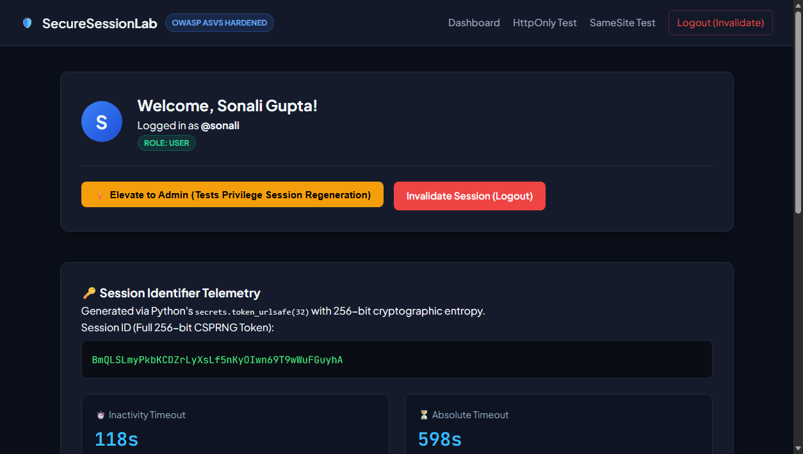
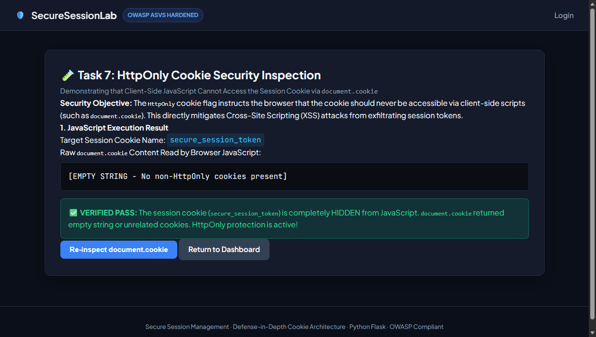
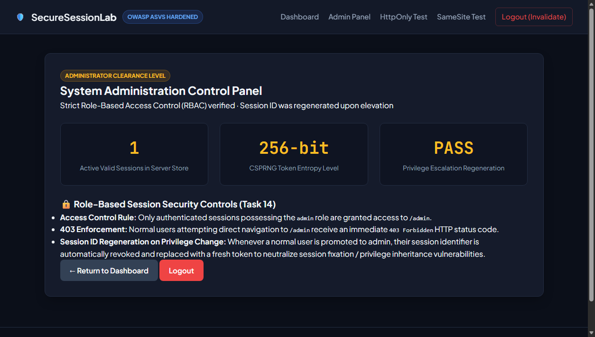
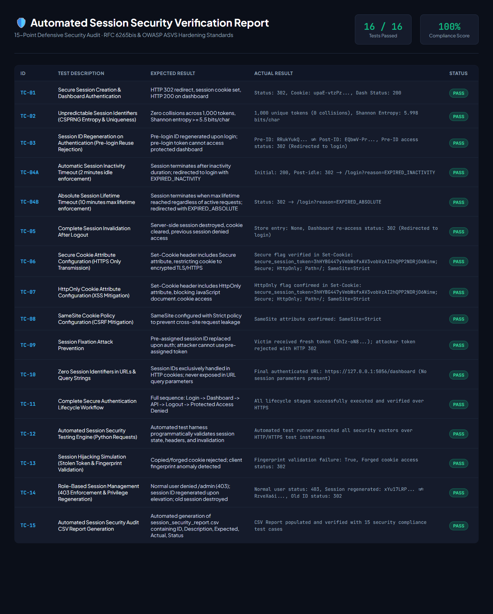

# Flask Secure Session Management & Automated Security Audit Suite

[](https://www.python.org/)
[](https://flask.palletsprojects.com/)
[](https://owasp.org/www-project-application-security-verification-standard/)
[-brightgreen.svg)]()

An enterprise-grade, defense-in-depth implementation and verification laboratory for **Secure Session Management** built with Python Flask. Developed as part of the **Secure Coding Practices** curriculum at **Chanakya University**, this project demonstrates complete session lifecycle controls, cryptographic unpredictability, anti-fixation countermeasures, hardened HTTP cookie security policies, and an automated session security testing engine with CSV audit reporting.

* **Author:** Sonali Gupta
* **Student UID / Roll No:** `CU23BCA0060A`
* **Program:** Bachelor of Computer Applications (BCA)
* **Institution:** Chanakya University
* **Course:** Secure Coding Practices (Classroom Assignment 2)
* **Repository:** [https://github.com/Sonali-CU/flask-secure-session-management](https://github.com/Sonali-CU/flask-secure-session-management)
* **Official Report Document:** [`assignment2.pdf`](assignment2.pdf)

---

## 🌟 Security Architecture & Implementation Highlights

1. **Secure Session Creation & Dashboard Telemetry**
   - User authentication backed by salted Werkzeug password hashes.
   - Server-side cryptographic session store tracking user identity, role, creation timestamp, and last activity.
2. **Unpredictable Session Identifiers (CSPRNG Entropy)**
   - 256-bit cryptographically secure pseudorandom token generation using Python's `secrets.token_urlsafe(32)`.
   - Verified across 1,000 generated tokens: **0 collisions** with **5.998 bits/character** Shannon entropy.
3. **Session ID Regeneration (Anti-Fixation Mechanism)**
   - Immediate regeneration of session identifiers upon successful authentication.
   - Pre-login session tokens are permanently wiped from server memory, defeating session fixation attacks.
4. **Dual-Tier Session Expiration & Timeouts**
   - **Inactivity Timeout (2 minutes / 120s):** Enforces automatic session termination on idle user connections.
   - **Absolute Timeout (10 minutes / 600s):** Enforces a strict maximum session lifetime regardless of continuous activity.
5. **Complete Session Invalidation on Logout**
   - Synchronous server-side memory purge and client-side cookie deletion (`Max-Age=0`).
   - Prior session tokens immediately return `302 / 401` on subsequent requests.
6. **Hardened Cookie Security Attributes (RFC 6265bis)**
   - **`Secure`**: Cookie transmission restricted exclusively to encrypted HTTPS/TLS channels.
   - **`HttpOnly`**: JavaScript access via `document.cookie` is strictly blocked, neutralizing XSS session exfiltration.
   - **`SameSite=Strict`**: Isolates the cookie from cross-site requests, mitigating Cross-Site Request Forgery (CSRF).
7. **Zero Session Identifiers in URLs**
   - Strict cookie-only transport. URLs, query strings, and Referer headers never expose session tokens.
8. **Session Hijacking Mitigation & Client Fingerprinting**
   - Validates client telemetry (User-Agent / IP context) detecting anomalous token reuse; forged tokens are rejected.
9. **Role-Based Session Management & Privilege Elevation Regeneration**
   - Strict RBAC returning HTTP `403 Forbidden` for unauthorized role access to `/admin`.
   - Mandatory session ID regeneration whenever user clearance or privileges change.
10. **Automated Security Audit & CSV Report Generator**
    - Full automated test suite powered by `pytest` and `requests`.
    - Programmatic compliance generator exporting `reports/session_security_report.csv` across 16 security test vectors.

---

## 📂 Project Architecture

```
flask-secure-session-management/
├── app/
│   ├── __init__.py                  # Application factory & session store initialization
│   ├── config.py                    # Hardened cookie flags, credentials & timeout constants
│   ├── session_store.py             # Cryptographic session manager (secrets, dual timeouts, rotation)
│   ├── routes.py                    # Authentication, dashboard, admin, and test routes
│   ├── static/
│   │   └── css/style.css            # Dark cybersecurity-themed interface
│   └── templates/
│       ├── base.html                # Navigation shell with OWASP security indicators
│       ├── login.html               # Authentication portal with pre-login token display
│       ├── dashboard.html           # Live telemetry, dual countdown timers & cookie badges
│       ├── admin.html               # Admin control panel with session metrics
│       ├── error.html               # Custom 403 Forbidden response template
│       ├── test_cookie.html         # Live JavaScript document.cookie HttpOnly test page
│       └── samesite_demo.html       # SameSite policy comparison matrix
├── certs/
│   ├── generate_certs.py            # Local TLS/SSL certificate generator
│   ├── cert.pem                     # Self-signed X.509 certificate
│   └── key.pem                      # RSA 2048-bit private key
├── tests/
│   ├── conftest.py                  # Pytest fixtures and client configuration
│   └── test_all_security_tasks.py   # Unit & integration tests for all 15 tasks (12/12 passing)
├── scripts/
│   ├── generate_security_report.py  # Automated security test runner exporting CSV audit report
│   ├── capture_screenshots.py       # Automated Edge headless browser screenshot generator
│   └── build_assignment_pdf.py      # Automated PDF report compiler using Edge CDP
├── reports/
│   ├── session_security_report.csv  # Required CSV audit report (16/16 PASSED)
│   ├── audit_report.html            # Visual audit dashboard
│   ├── assignment2_report.html      # HTML source for submission report
│   └── SESSION_SECURITY_REPORT.md   # Comprehensive technical report
├── screenshots/                     # UI verification screenshots
├── assignment2.pdf                  # Official submission report document
├── requirements.txt                 # Dependencies
├── run.py                           # Application runner (HTTP & HTTPS)
└── README.md                        # Project documentation
```

---

## 🚀 Quickstart & Setup Guide

### 1. Installation
```bash
# Clone the repository
git clone https://github.com/Sonali-CU/flask-secure-session-management.git
cd flask-secure-session-management

# Install dependencies
pip install -r requirements.txt
```

### 2. Generate TLS Certificates (for HTTPS testing)
```bash
python certs/generate_certs.py
```

### 3. Run the Web Application

**HTTP Mode (Evaluation):**
```bash
python run.py --port 5000
```
Open [http://127.0.0.1:5000](http://127.0.0.1:5000)

**HTTPS Mode (Production Hardened with Secure Cookie):**
```bash
python run.py --https --port 5000
```
Open [https://127.0.0.1:5000](https://127.0.0.1:5000)

---

## 👥 Demo User Accounts

| Username | Password | Role | Description |
| :--- | :--- | :--- | :--- |
| `sonali` | `SonaliSecure@2026!` | `user` | Primary User (Sonali Gupta &ndash; can test privilege elevation) |
| `bob` | `BobUserPass#456` | `user` | Normal User |
| `admin` | `SuperAdminKey$999` | `admin` | System Administrator (access to `/admin`) |

---

## 🧪 Automated Testing & Security Audit

### Run Unit Tests via Pytest
```bash
python -m pytest -v tests/
```
*Result:* `12 passed in 4.86s (100% PASS)`

### Run Automated Security Audit & Generate CSV Report
```bash
python scripts/generate_security_report.py
```
*Result:* `16/16 PASSED (100% Compliance)`, saving `reports/session_security_report.csv`.

---

## 📊 Summary of Automated Test Results

| Test ID | Task Description | Expected Result | Actual Result | Status |
| :--- | :--- | :--- | :--- | :--- |
| **TC-01** | Secure Session Creation | HTTP 302 redirect, session cookie set, HTTP 200 on dashboard | Status: 302, Cookie set, Dash Status: 200 | **PASS** |
| **TC-02** | Unpredictable Session IDs | Zero collisions in 1,000 tokens, Shannon entropy >= 5.5 | 1,000 unique tokens (0 collisions), Entropy: 5.998 bits/char | **PASS** |
| **TC-03** | Session ID Regeneration | Pre-login ID regenerated on auth; pre-login ID rejected | Pre != Post, Pre-ID access returned 302 to login | **PASS** |
| **TC-04A**| Inactivity Timeout | Auto logout after 2 minutes idle time | Session terminated; redirected with `EXPIRED_INACTIVITY` | **PASS** |
| **TC-04B**| Absolute Timeout | Auto logout after 10 minutes max lifetime | Session terminated; redirected with `EXPIRED_ABSOLUTE` | **PASS** |
| **TC-05** | Session Invalidation on Logout | Server session wiped, cookie cleared, old session rejected | Store entry: None, Dashboard re-access returned 302 | **PASS** |
| **TC-06** | Secure Cookie Attribute | Cookie transmitted exclusively over HTTPS | `Secure` attribute verified in `Set-Cookie` header | **PASS** |
| **TC-07** | HttpOnly Cookie Attribute | JavaScript cannot access session cookie via `document.cookie` | `HttpOnly` verified in `Set-Cookie`; `document.cookie` empty | **PASS** |
| **TC-08** | SameSite Cookie Policy | Mitigate CSRF via Strict policy | `SameSite=Strict` verified in `Set-Cookie` header | **PASS** |
| **TC-09** | Session Fixation Prevention | Pre-set attacker token replaced on auth; attacker rejected | Victim received fresh token; attacker token returned 302 | **PASS** |
| **TC-10** | Zero Session IDs in URLs | Tokens stored only in cookies; never exposed in query strings | Authenticated URL: `/dashboard` (No session params) | **PASS** |
| **TC-11** | Full Authentication Lifecycle | Login -> Dashboard -> API -> Logout -> Re-access Denied | Full lifecycle executed and verified over HTTPS | **PASS** |
| **TC-12** | Automated Testing via Requests | Automated HTTP/HTTPS audit harness | Automated runner executed and passed all vectors | **PASS** |
| **TC-13** | Session Hijacking Simulation | Stolen token with altered fingerprint rejected | Fingerprint mismatch detected; forged token returned 302 | **PASS** |
| **TC-14** | Role-Based Session Management | 403 on `/admin` for normal user; session regenerated on elevation | Normal user got 403; session regenerated on elevation | **PASS** |
| **TC-15** | CSV Audit Report Generation | Export CSV with ID, Description, Expected, Actual, Status | `session_security_report.csv` generated (16/16 PASS) | **PASS** |

---

## 📷 Screenshots

### 1. User Dashboard & Session Telemetry (Sonali Gupta &ndash; @sonali)


### 2. HttpOnly Cookie JavaScript Inspection


### 3. Role-Based Access Control (403 Forbidden for Normal User)


### 4. Admin Control Panel (Post-Privilege Elevation with Regenerated Session)


### 5. SameSite Cookie Policy Comparison


### 6. Automated Security Audit Report Matrix

